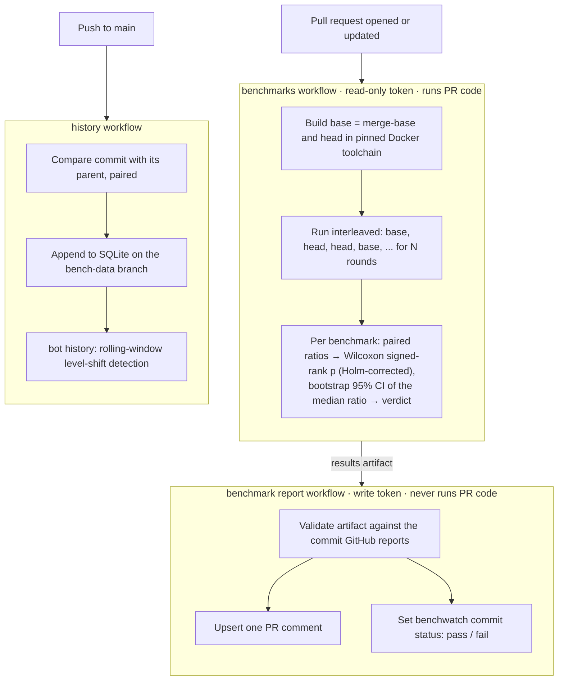

# Benchwatch

**Did this pull request make anything slower, and how sure are we?**

Benchwatch benchmarks every pull request against the commit it branched from and posts one PR
comment with a verdict per benchmark (regression, improvement, unchanged, or inconclusive), with
an effect size and a confidence interval. A commit status fails the check when a benchmark
regresses. Every commit merged to `main` is also recorded, so slow creep that no single PR causes
shows up as a level shift.

It targets C++ projects that use [Google Benchmark](https://github.com/google/benchmark) and CMake.

> ### Benchwatch: 🔴 3 regressions
> Base `a9dbd88` vs head `1e4f825` · 15 interleaved rounds · threshold ±3% · α = 0.01
>
> | Benchmark | Base | Head | Change | 95% CI | Verdict |
> |---|--:|--:|--:|--:|---|
> | `BM_Sort/4096` | 159 us | 340 us | **+113.9%** | +112.9% to +115.2% | 🔴 regression |
> | `BM_Sort/65536` | 3.99 ms | 7.7 ms | **+93.5%** | +92.9% to +94.2% | 🔴 regression |
> | `BM_Sort/1048576` | 79.9 ms | 158 ms | **+97.4%** | +97.1% to +98.0% | 🔴 regression |
>
> ▸ 11 other benchmarks (11 unchanged)
>
> *A real comment from this repo: a test PR that swapped `std::sort` for `qsort`. The other 11
> benchmarks, whose code didn't change, were all judged unchanged.*

## Why this is harder than it looks

Running benchmarks is easy. The hard part is telling a real slowdown from noise: timings jitter by
several percent between runs, and on shared CI machines also between machines, between minutes,
and with whichever neighbour is busy. Comparing a PR run with a baseline stored last week mostly
measures the difference between two machines.

Benchwatch never compares against stored numbers. It builds **both** the base and the head
commit in the same job and runs them **interleaved** on the same machine: base, head, head, base,
base, head, … Each round gives a matched pair, so whatever the machine is doing affects both
sides of the pair alike, and the per-round ratio `head / base` cancels it. All the statistics work
on those paired ratios.

## How it works



## Use it in your repository

1. Copy [`examples/workflows/benchmarks.yml`](examples/workflows/benchmarks.yml) and
   [`benchmark-report.yml`](examples/workflows/benchmark-report.yml) into `.github/workflows/`,
   and add steps that install what your benchmarks need to build.
   [`history.yml`](examples/workflows/history.yml) is optional.
2. Add a `.benchbot.yml` that points at your benchmark target (see below).
3. Merge to the default branch. GitHub only runs `workflow_run` workflows that are there.
4. Optionally make the `benchwatch` status a required check, to block merging on regressions.

The action ([`action.yml`](action.yml)) has four modes: `compare` (PR job), `pending` and
`publish` (report job), and `record` (push to main).

## Configuration

`.benchbot.yml` at the repository root sets defaults for every command. A command-line flag
overrides the file. In pull requests the file is read from the **base** commit, so a PR can't
loosen its own check.

| Key | Default | Meaning |
|---|---|---|
| `source_dir` | `target` | CMake source directory, relative to the repo root |
| `bench_target` | `bench` | CMake target that builds the Google Benchmark executable |
| `cmake_args` | `[]` | Extra CMake arguments for every build |
| `rounds` | `15` | Interleaved rounds per comparison |
| `warmup` | `1` | Leading rounds discarded |
| `min_time` | `0.1` | Google Benchmark min time per benchmark per run, in seconds |
| `filter` | all | Regex of benchmarks to run, e.g. a fast subset for PRs |
| `ignore` | `[]` | Regexes of benchmarks to run but never judge |
| `alpha` | `0.01` | Family-wise significance level across all benchmarks |
| `threshold` | `0.03` | Smallest change that counts (0.03 = 3%) |
| `window` | `10` | Commits on each side of a candidate level shift |

This repository's own file is [`.benchbot.yml`](.benchbot.yml).

## The statistics

For each benchmark, over the rounds left after warmup:

- **Effect size:** the median of the per-round ratios `head / base`, with a 95% bootstrap
  confidence interval.
- **Significance:** a Wilcoxon signed-rank test on `log(head / base)`. It's paired, because the
  rounds are, and non-parametric, because timing distributions are skewed and heavy-tailed.
- **Multiple comparisons:** Holm correction across all benchmarks, so α bounds the chance of
  *any* false alarm in a PR, not per benchmark. Without it, 20 benchmarks at p < 0.01 would
  produce a false alarm in about 1 PR in 5.

| Verdict | Rule |
|---|---|
| 🔴 regression | significant **and** the whole CI is more than `threshold` slower |
| 🟢 improvement | significant **and** the whole CI is more than `threshold` faster |
| ⚪ unchanged | the whole CI lies within ±`threshold`: any change is too small to matter |
| 🟡 inconclusive | none of the above: too noisy to rule a change in or out |

Requiring both significance and a practically large effect means a real but tiny change
(say +0.5%) is reported as unchanged instead of failing the build. *Inconclusive* is an honest
answer, distinct from *unchanged*: it says "run more rounds", not "all clear". The bot also warns
when there are too few rounds for any benchmark to reach significance after correction. With 14
benchmarks at α = 0.01 that takes at least 12 usable rounds.

## Validation

**GitHub-hosted runner: pending.** The [`validate`](.github/workflows/validate.yml) workflow
measures detection power and the false-alarm rate on the same kind of machine that benchmarks the
PRs. That run hasn't been done yet; its headline result will go here.

How validation works: `bot collect` builds one commit with synthetic slowdowns of known size
(0% twice for an A/A pair, then 1%, 3%, 5%, 10%), injected by a calibrated busy-wait in every
benchmark iteration ([`inject.hpp`](target/bench/inject.hpp)). Each variant runs right next to its
own reference run for 40 rounds. `bot simulate` then draws thousands of virtual PR runs of N rounds
from that pool and applies the real statistics. That gives detection rate per slowdown size and
the false-alarm rate per PR, for any round count, without thousands of CI jobs.

**What has been measured so far:**

- **On the GitHub runner,** in the planted-regression PR above, the 11 untouched benchmarks had
  95% CIs mostly within ±2%, and all were judged unchanged.
- **On a laptop** (WSL2 + Docker, hybrid P/E-core CPU), back-to-back runs of the *same binary*
  differed by 7–38% per round. There Benchwatch failed safe: identical code was flagged in only
  0.3% of virtual PRs, but a 10% slowdown was caught only 7% of the time at 15 rounds. Most
  benchmarks came back *inconclusive*. Full results:
  [`validation/results/laptop-docker`](validation/results/laptop-docker/REPORT.md).

## History and level shifts

The PR check ignores changes below its threshold, so five PRs that each add 1% are never flagged.
`bot history` finds that creep in the recorded series for `main`. At each commit it compares the
10 commits before with the 10 after (Mann-Whitney U, Bonferroni-corrected for the positions
scanned) and reports a **level shift** when the change is significant and above the threshold.

```sh
git fetch origin bench-data && git show origin/bench-data:benchwatch-history.db > history.db
uv run bot history --db history.db                    # every benchmark, with any level shifts
uv run bot history BM_Sort/65536 --db history.db      # one benchmark, commit by commit
```

In a reproducible demo ([`validation/history_demo.py`](validation/history_demo.py)) of 24
commits, five consecutive commits each added 1%. Every per-commit check said *unchanged* or
*inconclusive*. `bot history` found level shifts of +4.4% to +4.9% (5% planted) in all three
benchmarks, each inside the five slowing commits.

<picture>
  <source media="(prefers-color-scheme: dark)" srcset="validation/history-demo/history-dark.png">
  
</picture>

Absolute timings are only comparable on the same CPU, and GitHub-hosted runners vary: one
recorded run landed on an AMD EPYC 9V74 that was 1.8× to 5× faster, depending on the benchmark,
than the runner used for the PR above. Each run records its CPU model, and `bot history` analyses one model's series at a time.

## Design decisions

- **Interleave, and pair the rounds.** This is the decision everything else rests on (see
  [above](#why-this-is-harder-than-it-looks)). Order alternates each round, so "second run is
  faster" effects cancel too.
- **Compare against the merge-base, not the tip of `main`.** Otherwise unrelated commits merged
  to `main` since the branch point would show up in the PR's diff.
- **Fork-safe CI.** The job that runs PR code has a read-only token. A separate `workflow_run`
  job, running only default-branch code, posts results, and first checks that the artifact
  belongs to the commit GitHub reports for the run.
- **Settings from the base commit.** A PR can't raise its own threshold.
- **Pinned toolchain.** CI builds in a Docker image with a fixed compiler, so both sides, and all
  runs over time, compile with the same GCC.
- **Validation pools pair each variant with its own adjacent reference run.** A first design ran
  all variants round-robin against one reference. Pairs that ended up several runs apart were
  measurably noisier (6.2% → 8.7% per round) and understated detection power.
- **Rolling-window level shifts.** Binary segmentation over the whole series, tried first, missed
  a regression followed by its fix, a common pattern in real repos. Local windows see the rise
  and the fall separately.

## Limitations

- **Code layout effects.** Changing one function can move another function's machine code in
  memory and change its speed. Swapping in heapsort made the untouched CSV parser 4–6% slower
  under MSVC, reproducibly. Benchwatch correctly reports that the binary got slower but can't say
  which source change caused it.
- **Noisy machines give inconclusive answers.** That's by design, but on a busy laptop most
  verdicts will be *inconclusive*. Use CI runners or a quiet dedicated machine (`--cpu` pins runs
  with `taskset` on Linux).
- **Level shifts need history on both sides.** A shift less than `window` commits from either end
  of the series can't be confirmed yet.
- **C++ / CMake / Google Benchmark only.**

## Development

The repository contains the bot (Python, in `benchwatch/`) and a small C++20 library, `perfkit`
(in `target/`), that serves as its benchmark target. `perfkit` has kernels with different
performance profiles (sorting, an open-addressing hash map, CSV integer parsing, a memory-bound
strided walk), plus deliberately slower versions in `perfkit::slow` for planting real regressions.
All inputs come from a fixed-seed generator, so they are identical across compilers.

```sh
uv sync --extra plot                 # Python 3.11+, via https://docs.astral.sh/uv/
uv run pytest                        # bot tests

cmake -S target -B build -DCMAKE_BUILD_TYPE=Release && cmake --build build -j
ctest --test-dir build               # perfkit correctness tests (Catch2)

uv run bot compare --base HEAD --head HEAD     # A/A self-test: expect no flags
uv run bot compare --base HEAD --head HEAD --head-cmake-arg=-DPERFKIT_INJECT_SLOWDOWN_PCT=10
```

Commands: `compare`, `analyze` (re-run statistics on saved results), `collect` / `simulate`
(validation), `record` / `history` (trends), `publish` / `pending` (CI), `clean`. Run `bot <command>
--help` for options. On Windows (MSVC), keep the repository at a short path, because MSBuild
fails on paths over 260 characters.

```
benchwatch/      the bot: runner, parse, stats, report, github, store, changepoint, validate, plot
target/          perfkit C++ library, Google Benchmark targets, Catch2 tests
action.yml       reusable GitHub Action
.github/         this repo's own CI (benchmarks, report, history, validate)
examples/        workflows to copy into another repository
validation/      pools, simulation results, history demo
docker/          pinned toolchain image
```
