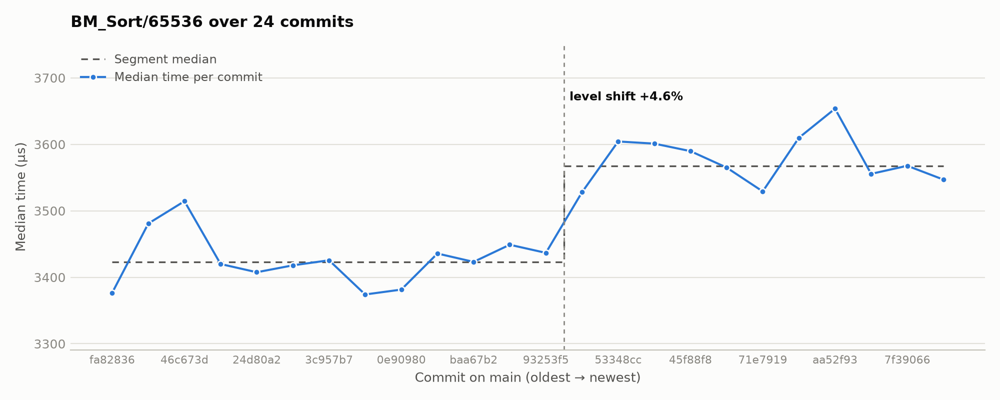

# Benchwatch

Benchmarks every pull request against its merge-base and reports, per benchmark, whether
the change caused a statistically meaningful slowdown.

## Benchmark target (`target/`)

A small C++20 library, `perfkit`, with kernels of different performance profiles:

| Kernel | Benchmarks | Profile |
|---|---|---|
| `sort_ints` (std::sort) | `BM_Sort/{4K,64K,1M}` | compute, branchy |
| `FlatMap` (open addressing) | `BM_FlatMapLookup/{1K,64K,1M}` | cache / latency |
| std::unordered_map (reference) | `BM_StdUnorderedMapLookup/{1K,64K,1M}` | pointer chasing |
| `parse_csv_ints` (std::from_chars) | `BM_ParseCsvInts/{4K,64K}` | byte-at-a-time parsing |
| `strided_sum` | `BM_StridedSum/{32KiB,8MiB,64MiB}` | memory bandwidth (64MiB is deliberately noisy) |

Each function in `perfkit::slow` (qsort, stoll-based parser) is a correct but slower version of the matching production function. Swap one in to plant a real algorithmic regression.
All inputs come from a fixed-seed SplitMix64 generator, so they are identical across compilers and platforms.

### Build and run

Linux / WSL / Docker:

```sh
cmake -S target -B build -DCMAKE_BUILD_TYPE=Release
cmake --build build -j
ctest --test-dir build --output-on-failure
./build/bench --benchmark_format=json --benchmark_repetitions=5
```

Windows (MSVC):

```sh
cmake -S target -B build -G "Visual Studio 17 2022" -A x64
cmake --build build --config Release
ctest --test-dir build -C Release --output-on-failure
build/Release/bench.exe --benchmark_format=json --benchmark_repetitions=5
```

### Synthetic slowdown injection

To validate the detector against slowdowns of known size, build a second copy with:

```sh
cmake -S target -B build-inject5 -DPERFKIT_INJECT_SLOWDOWN_PCT=5
```

Every benchmark iteration then busy-waits for an extra 5% of its own measured duration
(see `target/bench/inject.hpp`). At the default of `0` the hook compiles away entirely.

## Comparing two commits (`bot`)

Requires [uv](https://docs.astral.sh/uv/), CMake, and a C++20 compiler.

```sh
uv sync
uv run bot compare --head my-branch            # base defaults to merge-base(main, head)
uv run bot compare --base main --head HEAD --rounds 20 --filter "BM_Sort"
uv run bot analyze results/<run-id> --threshold 0.05   # re-run stats on saved data
uv run bot clean                                        # remove cached worktrees and builds
```

`compare` checks out each revision into a git worktree under `.benchwatch/`, builds it,
then runs base and head alternately (base-head, head-base, ...) for `--rounds` rounds.
Raw Google Benchmark JSON for every run is kept under `results/<run-id>/`.

For each benchmark it reports the median of the per-round head/base ratios, a bootstrap
95% CI, and a Wilcoxon signed-rank p-value with Holm correction across all benchmarks.
Verdicts:

| Verdict | Meaning |
|---|---|
| regression | significant, and the whole CI is more than `--threshold` slower |
| improvement | significant, and the whole CI is more than `--threshold` faster |
| unchanged | the CI lies within ±threshold: any change is smaller than we care about |
| inconclusive | too noisy to tell; more rounds would help |

The exit status is 1 when any regression is found, which lets CI fail the check.

Self-tests without a code change:

```sh
uv run bot compare --base HEAD --head HEAD                                     # A/A: expect no flags
uv run bot compare --base HEAD --head HEAD --head-cmake-arg=-DPERFKIT_INJECT_SLOWDOWN_PCT=10
```

On Windows, keep the repository at a short path: MSBuild fails on paths over 260 characters.

## CI (GitHub Actions)

Two workflows run on every pull request:

1. **`benchmarks`** ([bench.yml](.github/workflows/bench.yml)) checks out the PR, builds the
   pinned toolchain image ([docker/Dockerfile](docker/Dockerfile): Ubuntu 24.04, GCC, CMake, uv),
   and runs `bot compare` inside it against the merge-base. It has a read-only token, uploads
   `results.json`, `comment.md` and the raw timings as an artifact, and fails only if the run
   itself breaks.
2. **`benchmark report`** ([bench-report.yml](.github/workflows/bench-report.yml)) is triggered by
   the first via `workflow_run`. It runs the default branch's code with a write token, sets a
   `benchwatch` commit status (pending → success/failure), and posts or updates a single PR comment.

Running PR code and holding a write token never happen in the same job. That's what makes
benchmarking PRs from forks safe. `bot publish` also refuses to post if the artifact's PR number
doesn't match the commit GitHub reports for the run.

To block merging on regressions, make the `benchwatch` status a required check in branch protection.

Note: GitHub only runs `workflow_run` workflows that exist on the **default branch**, so the
comment and status appear only after `bench-report.yml` has been merged there.

Run the CI build locally (needs Docker):

```sh
docker build -f docker/Dockerfile -t benchwatch-toolchain .
docker run --rm -v "$PWD:/work" benchwatch-toolchain sh -c \
  'uv sync --frozen --no-dev && uv run --no-sync bot compare --base HEAD~1 --head HEAD --markdown out/comment.md'
```

## History and trends

Every push to `main` runs the **`history`** workflow ([bench-main.yml](.github/workflows/bench-main.yml)).
It compares the new commit with its parent using the same interleaved, paired runs as a PR, then
appends the result to a SQLite database on the `bench-data` branch. Each row has the commit's
absolute median time, for trends, and its paired change against its parent.

```sh
git fetch origin bench-data && git show origin/bench-data:benchwatch-history.db > history.db
uv run bot history --db history.db                     # every benchmark, with any level shifts
uv run bot history BM_Sort/65536 --db history.db       # one benchmark, commit by commit
uv sync --extra plot && uv run bot history BM_Sort/65536 --db history.db --plot trend.png
```

**Why look at history at all?** The PR check ignores changes below its threshold (3%), so five
PRs that each add 1% are never flagged. `bot history` scans the series for **level shifts**: at
each commit it compares the 10 commits before with the 10 after (Mann-Whitney U), Bonferroni-
corrected for the positions scanned, and requires the median shift to exceed the threshold.
Local windows see a regression and its later fix as two separate shifts. A whole-series
binary segmentation, tried first, misses that case. The cost: a shift less than 10 commits from
either end of the history can't be confirmed yet.

Absolute times are only comparable on the same CPU. GitHub-hosted runners vary, so each run
records the CPU model and `bot history` uses one model's series at a time (`--cpu-model`).

`validation/history_demo.py` builds a reproducible demo: 24 commits where five consecutive ones
each add a 1% slowdown, every one compared with its parent and recorded.

In the recorded demo every per-commit check came back *unchanged* or *inconclusive*, while
`bot history` found the creep in all three benchmarks: level shifts of +4.4% to +4.9%
(5% planted), each placed inside the five slowing commits.

<picture>
  <source media="(prefers-color-scheme: dark)" srcset="validation/history-demo/history-dark.png">
  
</picture>
